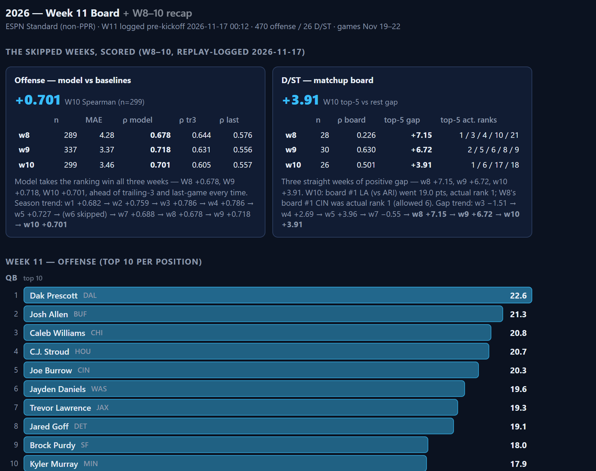
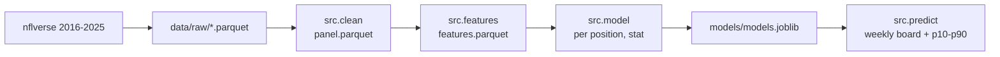

# Winning-NFL-Fantasy-Model

Per-player weekly NFL fantasy stat projection (passing / rushing / receiving components, targets, receptions, carries) with `p10`–`p90` uncertainty bands, ranked field-wide before kickoff. ESPN Standard (non-PPR).

[](pyproject.toml)
[](pyproject.toml)
[](LICENSE)



Live Week 11, 2026 board (top of the board). Full board: all 10 positions + the 26-team D/ST, with charts and methodology: [docs/RESULTS.md](docs/RESULTS.md).

## Highlights

- **Strict holdout discipline**: 2025 is never used in training, and 2026 predictions are written to disk **before kickoff** and scored after the games, never re-fit on a week you're about to score. That's the only test that counts.
- **Calibrated per-player projections**: one `HistGradientBoostingRegressor` per (position, stat), with the point estimate fit to the **conditional mean** (not the median) so `E[points] = Σ score·E[stat]` holds across positions and flex; `p10`/`p90` bands stay quantile models.
- **Leak-free features**: every trailing/rolling feature uses only strictly-prior weeks, proven by `tests/test_no_lookahead.py` (remove the `shift(1)` and it fails).
- **Matchup-based D/ST board**: ranks by the **opponent's** Vegas implied team total (lowest first) plus flat league-mean sacks/turnovers, deterministic from pre-kickoff data, nothing to leak.

## Quick Start

Requires Python 3.11+ and [`uv`](https://docs.astral.sh/uv/). The core dataset (nflverse, via `nflreadpy`) needs **no API key**; the FantasyPros/ESPN head-to-head and the CFBD rookie prior use free keys in `.env`.

```bash
uv sync --python 3.11
uv run python -m src.download_data --datasets all   # mirror nflverse -> data/raw/
```

Build the panel, features, and models (chronological split: train 2016–2023 · val 2024 · test 2025):

```bash
uv run python -m src.clean      # -> data/processed/panel.parquet   (REG-only, deduped)
uv run python -m src.features   # -> data/processed/features.parquet  (leak-free)
uv run python -m src.model      # trains + evaluates -> models/
```

Project a week and render the board:

```bash
uv run python -m src.predict --season 2026 --week 6 --players "Patrick Mahomes"
uv run python -m src.predict --season 2026 --week 6 --all --refresh
```

Artifacts are written to `models/`:

```text
models/models.joblib                 # per-(position, stat) regressors
models/eval_report.json              # 2025 holdout MAE / RMSE / bias / Spearman + baselines
models/holdout_log.jsonl             # append-only pre-kickoff predictions (offense)
models/holdout_score.json            # scored live-2026 weeks (offense)
models/holdout_log_def.jsonl         # D/ST pre-kickoff boards
models/calibration_report.json       # signed bias per position + by predicted decile
```

## Benchmarks

> [!NOTE]
> Numbers below are the verified runs re-executed 2026-11-19 on the cached holdouts. Every per-player model is fit on **2016–2023** and validated on **2024**; the clean holdout is **2025** (the model is never fit on 2025) and **2026 is the live out-of-sample season** (logged pre-kickoff, scored after the games). Baselines are the **last-game** and **trailing-3-game** averages on the same weeks and same players. Selection metric is **per-stat MAE and Spearman rank correlation**: MAE alone hides the systematic over/under-projection that distorts flex and start/sit. Re-run `src.bench`, `src.calibrate`, and the holdout scorers after any model change.

### Per-stat components (2025 clean holdout)

| Stat | Model MAE | last-game MAE | trailing-3 MAE | Spearman ρ |
| --- | ---: | ---: | ---: | ---: |
| QB passing yards | **53.8** | 81.0 | 75.5 | 0.62 |
| QB passing TDs | **0.78** | 1.06 | 0.94 | 0.50 |
| RB rushing yards | **16.7** | 23.6 | 20.6 | **0.80** |
| RB rushing TDs | **0.32** | 0.35 | 0.32 | 0.39 |
| RB receptions | **1.02** | 1.17 | 1.06 | 0.65 |
| RB receiving yards | **9.77** | 11.4 | 9.87 | 0.56 |
| WR receptions | **1.10** | 1.63 | 1.44 | 0.78 |
| WR receiving yards | **18.1** | 24.5 | 21.8 | 0.72 |
| TE receptions | **0.98** | 1.55 | 1.33 | 0.75 |
| TE receiving yards | **12.8** | 18.5 | 15.8 | 0.70 |

12 of the 16 stat models beat *both* naive baselines on MAE; the edge is largest on the headline yardage (QB passing 53.8 vs 81.0 / 75.5). The 4 that don't win are the ultra-sparse TD / INT counts, where "last week was 0" is a strong null. Spearman rank correlation is positive on all 16 stats. Full per-stat breakdown in `models/eval_report.json`.

### Live 2026: weekly pooled points MAE vs baselines

| Week | n | Model MAE | last-game | trailing-3 |
| --- | ---: | ---: | ---: | ---: |
| W1 | 357 | **3.65** | 5.87 | 5.87 |
| W2 | 359 | **3.41** | 4.29 | 4.29 |
| W3 | 362 | **3.18** | 4.27 | 3.90 |
| W4 | 338 | **3.58** | 4.24 | 3.65 |
| W5 | 320 | **4.04** | 4.60 | 4.08 |
| W7 | 293 | 4.07 | 4.42 | **3.75** |
| W8 | 289 | 4.28 | 4.35 | **3.86** |
| W9 | 337 | **3.37** | 4.27 | 3.66 |
| W10 | 299 | **3.46** | 4.66 | 4.08 |

Beats both baselines on MAE in **7 of 9** scored weeks (W7 and W8 are the two losses, both to trailing-3). It also produces a real ranking (Spearman **0.67–0.76** against actuals per position) while the naive baselines are a single constant for every player and so rank nothing at all.

### Live 2026: head-to-head vs the FantasyPros consensus

| Position | Our MAE | FP MAE | Our Spearman | FP Spearman |
| --- | ---: | ---: | ---: | ---: |
| QB | **5.98** | 6.37 | **+0.45** | +0.37 |
| RB | **6.66** | 6.98 | **+0.30** | +0.30 |
| WR | 6.96 | **6.71** | 0.12 | **+0.14** |
| TE | **4.63** | 4.85 | **+0.32** | +0.21 |

Pooled across the field: points MAE **6.05 vs 6.22**, RMSE **7.57 vs 7.61**, Spearman **+0.534 vs +0.512**. We win 3 of 4 positions on accuracy and ranking (WR is the one we trail). n = 358 player-weeks, ESPN Standard (non-PPR); the FP free tier caps at top-10 per position, so this is a top-10 head-to-head, not a full-roster one, and the opponent is an aggregate of expert projections, not a single pick.

### D/ST: matchup, not team quality

Rank D/ST by the **opponent's** Vegas implied team total, **lowest first**: Spearman **+0.349 (2024) / +0.339 (2025)** vs actual D/ST points, the best ranker. A grid of 240 own-defense weights tops out at +0.336 and does not beat it, and adding a prior-season defense-quality prior is no better. Why the gut ("HOU / DEN / PHI are elite") disagrees with the board: a D/ST's fantasy value is almost entirely the points they **allow**, and points allowed is driven by **who they face**, not how good they are. The shipped board layers flat league-mean sacks (~2.36) and turnovers (~1.0) onto the points-allowed tier for a realistic absolute value (near-constants, ranking-invariant). It's deterministic from pre-kickoff data (Vegas lines + flat means), logged via `src.holdout_def` before kickoff, so there's nothing to leak.

## Architecture



## Evaluation & Tests

Run the unit suite, the baseline bench, and the calibration check:

```bash
uv run pytest tests/
uv run python -m src.bench        # model vs naive baselines (full roster, 2024-25)
uv run python -m src.calibrate    # signed bias per position + by predicted decile
```

Score a live holdout week: log before kickoff, score after the games.

```bash
uv run python -m src.holdout --season 2026 --week W --log
uv run python -m src.holdout --season 2026 --week W --score
uv run python -m src.holdout_def --season 2026 --week W --score
```

`tests/test_no_lookahead.py` proves the trailing features use only strictly-prior weeks and is non-vacuous (remove the `shift(1)` and it fails). `tests/test_partial_week_guard.py` guards the pre-kickoff scheduled-panel path.

<details>
<summary>Project layout and reference data sources</summary>

### Repository Layout

- `src/download_data.py`: resumable nflverse mirror to `data/raw/`
- `src/clean.py`: REG-only, deduped weekly panel
- `src/features.py`: leak-free trailing/rolling features (opponent, Vegas line, usage, NextGen Stats, participation)
- `src/model.py`: `HistGradientBoostingRegressor` per (position, stat); conditional mean for the point, quantiles for the bands
- `src/scoring.py`: ESPN Standard (non-PPR) scoring, single source of truth
- `src/predict.py`: per-player and full-board projection, scheduled-panel fallback, conformal band shifts
- `src/holdout.py` / `src/holdout_def.py`: log-before / score-after for offense and D/ST
- `src/bench.py` / `src/calibrate.py`: baseline bench + signed-bias / calibration
- `src/fetch_fantasypros.py` / `src/compare_fantasypros.py`: head-to-head vs the FP consensus
- `src/rookie_model.py`: rookie prior from college season stats
- `notebooks/`: per-week board renderers + A/B and diagnostics
- `docs/RESULTS.md`: full board, charts, and the methodology
- `tests/`: leak-free, partial-week, and metrics regression tests
- `NOTES.md`: full experiment log, settled decisions, and the A/B log

### Reference Data Sources

- **Player / team weekly stats, schedules, rosters, injuries, NextGen**: [nflverse](https://www.nflverse.com/) (via `nflreadpy`)
- **Fantasy consensus head-to-head**: [FantasyPros public API](https://fantasypros.com/api-data/) (free tier)
- **Rookie prior (college season stats, SP+)**: [College Football Data](https://cfbd.com/developers/)
- **Fantasy scoring reference**: [FantasyPros scoring](https://www.fantasypros.com/fantasy/scoring/), [ESPN fantasy](https://www.espn.com/)

</details>

## License

GNU General Public License v3.0: see [LICENSE](LICENSE).
