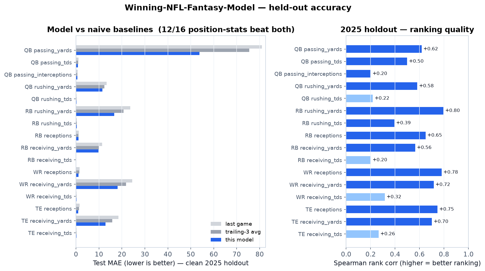
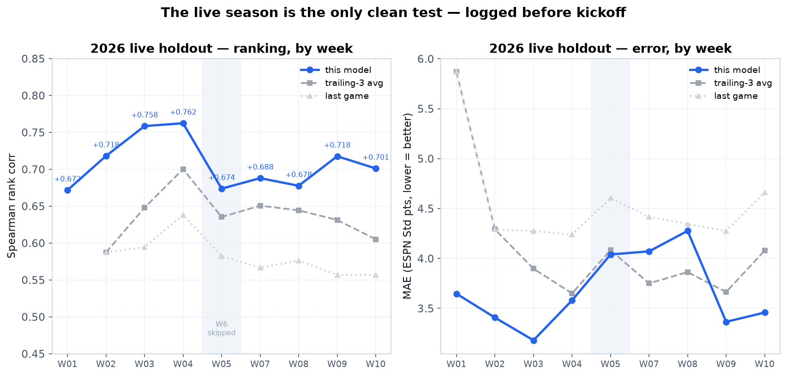

# Winning-NFL-Fantasy-Model

A prediction model for **NFL player performance**: it estimates the **stat
components** a player is likely to post in a given week — e.g.
"Patrick Mahomes will get ~2.1 touchdowns and ~268 passing yards."

We predict the raw stats (passing/rushing/receiving yards & TDs, receptions,
targets, carries, …). **Fantasy points are a separate, later project** that
converts these components — this repo does not score them.

## What it does

- Consumes historical NFL data (nflverse, 2016–2025) plus per-game context
  (opponent, Vegas line, weather, injuries, usage).
- Produces per-player per-week projections of individual stat components,
  with uncertainty (p10–p90) bands.

## Results

**The product — a full-roster weekly board.** Every week the model projects
all active players' stat components, converts them to ESPN Standard (non-PPR)
points, and ranks them. This is the live **Week 11, 2026 board** — top-10 per
offensive position plus the D/ST matchup board for all 26 teams — with the
most recently scored weeks recap'd at the top.


**Held-out accuracy.** On the clean 2025 holdout (the model was never fit on
2025), **12 of 16** position-stat models beat *both* naive baselines
(last-game and trailing-3 average) on MAE. The edge is largest on headline
yardage — e.g. QB passing yards MAE **53.8** vs 81.0 / 75.5 for the baselines
— and the model's Spearman ranking is positive on all 16.



**The live season is the only clean test.** 2026 predictions are written to
disk *before* kickoff and scored after the games — never re-fit on a week you
are about to score. The model takes the ranking (Spearman) win on **every**
scored week, ahead of trailing-3 and last-game each time (W1: 0.672 → W10:
0.701).



## Status

- **Phase 1** setup, **Phase 2** data acquisition, **Phase 3** cleaning +
  leakage-safe features, **Phase 4** model, **Phase 5** prediction CLI — all
  done and verified.
- **Phase 6** polish & documentation: in progress. Rookie prediction support
  (`src/rookie_*.py`, CollegeFootballData API) is under development.

## Setup

Requires Python 3.11+ and [uv](https://docs.astral.sh/uv/). No pip/conda by
hand — dependencies come from `pyproject.toml` / `uv.lock`.

```bash
uv sync --python 3.11
```

## Data pull (Phase 2)

All raw data is mirrored from the nflverse GitHub releases into `data/raw/`
(gitignored — re-run this on each new machine; takes ~1 minute):

```bash
uv run python -m src.download_data --datasets all
```

Files produced: `player_weekly_stats.parquet`, `team_weekly_stats.parquet`,
`schedules.parquet` (includes Vegas lines + weather), `players.parquet`,
`weekly_rosters.parquet`, `snap_counts.parquet`, `injuries.parquet`, plus
NextGen Stats and participation under `--datasets all`.

## Pipeline (Phases 3–4)

```bash
uv run python -m src.clean      # data/processed/panel.parquet (REG-only, deduped)
uv run python -m src.features   # data/processed/features.parquet (leak-free)
uv run python -m src.model      # trains + evaluates, writes models/
uv run python -m src.model --quick   # fast smoke test
```

- Split is **chronological**: train 2016–2023 | val 2024 | test 2025.
  (2024 was folded into training after we over-diagnosed on it; 2026 is the
  live pre-kickoff holdout via `src.holdout`.)
- Model: `HistGradientBoostingRegressor` per (position, stat). The **central
  estimate fits the conditional MEAN** (`loss="squared_error"`) — a median
  (quantile-0.5) systematically under-projects these right-skewed, zero-inflated
  stats (measured: RB/WR/TE 30–40% low, TDs collapsed to 0) and breaks the
  linearity needed for cross-position (flex) ranking. **p10/p90 bands** stay
  quantile models. Compared against naive baselines (last game, trailing
  3-game average): **12/16 position-stats beat both on test MAE** — the 4 that
  don't are the ultra-sparse TD/INT counts where "last week was 0" is a strong
  null. Headline yardage stats win clearly, e.g. QB passing yards MAE 53.8 vs
  81.0 / 75.5 baseline.
- Artifacts: `models/models.joblib` (models + p10/p90 band models + metadata)
  and `models/eval_report.json`. Calibration/signed-bias:
  `uv run python -m src.calibrate` → `models/calibration_report.json`.

## Prediction CLI (Phase 5)

```bash
# specific players for a week
uv run python -m src.predict --season 2024 --week 5 --players "Patrick Mahomes"

# ranked board (top 15 per position)
uv run python -m src.predict --season 2024 --week 5 --all

# compare against actuals (end-to-end sanity check for a past week)
uv run python -m src.predict --season 2024 --week 5 --all --compare --top 5

# machine-readable JSON
uv run python -m src.predict --season 2024 --week 5 --all --json

# upcoming week: re-pull the latest data + rebuild features first
uv run python -m src.predict --season 2026 --week 6 --all --refresh
```

Output looks like:

```
Patrick Mahomes (QB, KC vs NO) — Week 5, 2024
  1.0 passing TDs (0.0-2.8), 236 passing yards (136-323) and 0.0 interceptions
```

## Tests

```bash
uv run pytest tests/
```

`tests/test_no_lookahead.py` proves the trailing/rolling features use only
strictly-prior weeks (perturbing a week's targets leaves that week's features
unchanged, and the test is non-vacuous — removing the `shift(1)` makes it fail).

## Known limitations

- **Injury uncertainty**: the model sees prior-week snaps/usage but cannot
  know a player will be injured or inactive in the predicted week.
- **Rookies**: first-year players have little or no trailing history, so
  features collapse to zeros; a dedicated rookie path (CollegeFootballData)
  is under development.
- **TD projections**: TDs are rare, high-variance events; we now fit the
  conditional **mean** (not the median) so per-week TD expectations are
  calibrated (~0.1–1.3 depending on position/volume) instead of collapsing to
  0. Treat them as directional and lean on the p10–p90 bands.
- **Sparse-count MAE**: the ultra-sparse TD/INT count stats (receiving TDs,
  QB INTs) no longer beat the "last week was 0" null on raw MAE — fitting the
  mean trades a little MAE for correct calibration, which is the right call
  for flex decisions (see `src/calibrate.py`).
- **Shrinkage**: per-week receiving-yard projections compress toward the
  position mean (~50–66 yards for WR/TE); ranking by predicted value is more
  reliable than the absolute number.
- **Weather / OL changes**: weather is an input, but abrupt offensive-line
  changes mid-season are not modeled.
- **Vegas lines are inputs, not targets** — the model conditions on them and
  cannot out-predict the market's implied totals.
