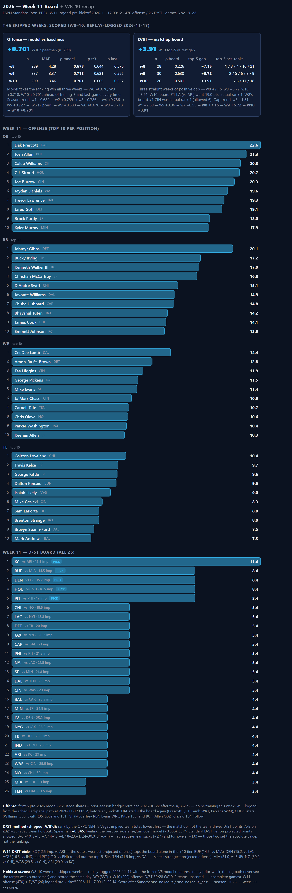
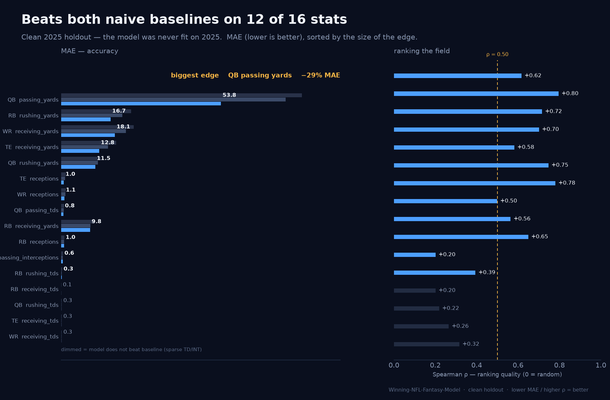
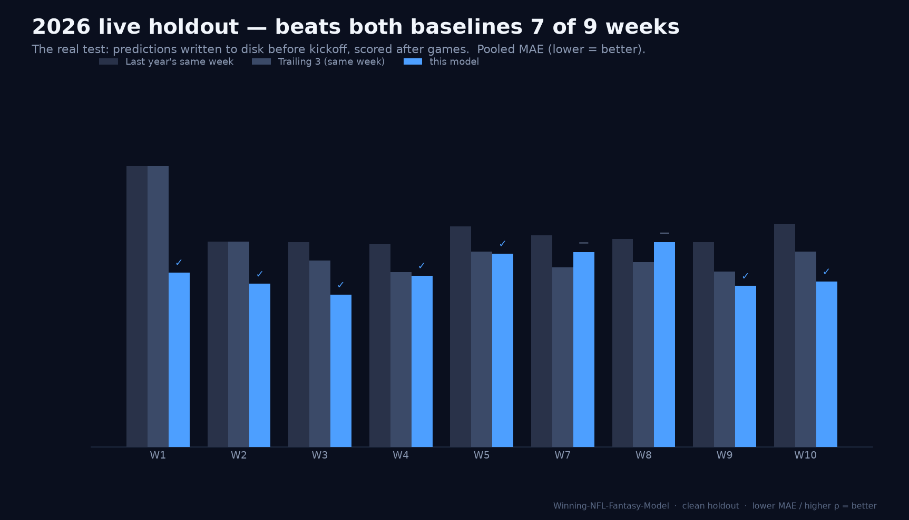

# Results — accuracy, charts, and the reasoning

This is the detailed results page: the held-out accuracy, the charts, and the
"why" behind each modeling choice. The README keeps only the headline; this is
where the evidence and methodology live. Agent working-notes and the A/B log:
[NOTES.md](../NOTES.md).

## The product — a full-roster weekly board

Every week the model projects all active players' stat components, converts them
to ESPN Standard (non-PPR) points, and ranks them. Below is the live **Week 11,
2026** board in full — top-10 per offensive position plus the D/ST matchup board
for all 26 teams, with the most recently scored weeks recap'd at the top.

## Held-out accuracy (clean 2025)

On the clean **2025 holdout** — the model was **never fit on 2025** — **12 of
16** position-stat models beat *both* naive baselines (last-game and trailing-3
average) on MAE. The edge is largest on headline yardage: QB passing yards MAE
**53.8** vs **81.0 / 75.5** for the two baselines. The model's Spearman ranking
is positive on all 16 stats. The 4 that don't win on raw MAE are the
ultra-sparse TD/INT counts, where "last week was 0" is a strong null.

### Why fit the conditional mean, not the median

The central estimate fits the **conditional mean** (`loss="squared_error"`). A
median (quantile-0.5) systematically under-projects these right-skewed,
zero-inflated stats — measured: RB/WR/TE projected 30–40% low and TDs collapsed
to 0 — and breaks the linearity needed for cross-position (flex) ranking. The
p10/p90 bands stay quantile models. Signed-bias / calibration:
`uv run python -m src.calibrate` → `models/calibration_report.json`.

## The live season is the only clean test

2026 predictions are written to disk **before** kickoff and scored after the
games — never re-fit on a week you are about to score (no in-sample leakage, no
peeking at the answer). It beats **both** baselines on MAE in **7 of 9** scored
weeks (W7 and W8 are the two losses). It also produces a real ranking — Spearman
**0.67–0.76** against actuals — while the naive baselines are a single constant
for every player and so rank nothing at all. This is the real test.

## Methodology recap

- **Data**: nflverse 2016–2025 + per-game context (opponent, Vegas line,
  weather, injuries, usage, NextGen Stats, participation).
- **Features**: leakage-safe — trailing/rolling features use only strictly-prior
  weeks, proven by `tests/test_no_lookahead.py`.
- **Model**: `HistGradientBoostingRegressor` per (position, stat); conditional
  **mean** for the point estimate, quantiles for the p10/p90 bands.
- **Baselines**: last-game and trailing-3-game average, same week, same players.
- **Split**: train 2016–2023 · val 2024 · test 2025 · 2026 live holdout.
- **Artifacts**: `models/models.joblib`, `models/eval_report.json`,
  `models/holdout_score.json`, `models/calibration_report.json`.
